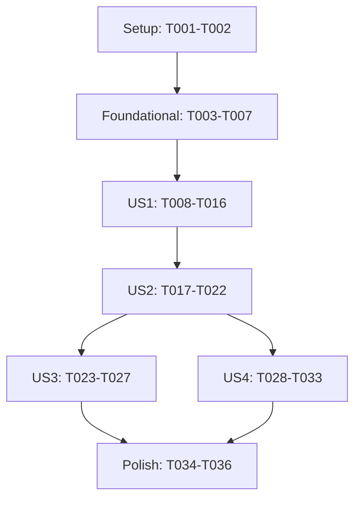

# Tasks: Automatic Rust Analyzer Configuration

**Input**: Design documents from `specs/012-rust-analyzer-config/`

**Prerequisites**: [plan.md](plan.md), [spec.md](spec.md), [research.md](research.md), [data-model.md](data-model.md), [contracts/rust-analyzer-configuration.md](contracts/rust-analyzer-configuration.md), and [quickstart.md](quickstart.md)

**Affected Product Areas**: `Configuration View`, `Rust Analyzer Configuration`, `Startup And Refresh Behavior`, and `Persistence And Defaults`.

**Required Glossary Terms**: `active build context`, `active preset`, `preset-effective value`, `build-option override`, `xtask`, `workflow task environment`, `Configuration view`, `Rust Analyzer configuration`, `Rust Analyzer mode`, `model-specific mode`, `all-features mode`, `managed Rust configuration`, and `Rust Analyzer conflict`.

**Tests**: Automated unit and extension-host integration tests are required by the feature specification and constitution. Write each story's tests before its implementation tasks and confirm they fail for the intended missing behavior first.

**Organization**: Tasks are grouped by user story so each completed phase is independently demonstrable.

## Phase 1: Setup

**Purpose**: Prepare test doubles and contribution surfaces needed by the new capability.

- [X] T001 [P] Extend Rust Analyzer API, extension-activation, context-key, and setting-inspection stubs in `src/test/unit/vscode-mock.ts`
- [ ] T002 [P] Add controllable Cargo generator output fixtures for hardware, emulator, malformed, and failing executions in `test-fixtures/rust-analyzer/`

---

## Phase 2: Foundational

**Purpose**: Build the reusable schema, parsing, and direct-process boundary required by all user stories.

**CRITICAL**: Complete this phase before starting any user story.

- [ ] T003 [P] Add failing TOML schema and flattening tests for supported keys, hardware/emulator required-key presence, opaque string-list `check.extraArgs`, unknown content, empty output, nested values, and wrong types in `src/test/unit/rust-analyzer/config-parser.test.ts`
- [ ] T004 Implement Rust Analyzer mode, configuration snapshot, managed-object, conflict, runner, and extension-API interfaces in `src/rust-analyzer/config-types.ts`
- [ ] T005 Implement atomic TOML parsing and supported-key validation in `src/rust-analyzer/config-parser.ts`
- [ ] T006 [P] Add failing direct-process runner tests for resolved cwd, merged task environment, stdout/stderr capture, exit status, and cancellation in `src/test/unit/rust-analyzer/config-runner.test.ts`
- [ ] T007 Implement cancellable `cargo xtask generate-rust-analyzer-config` spawning with existing repository workspace and task-environment resolution in `src/rust-analyzer/config-runner.ts`

**Checkpoint**: The capability has strict input boundaries and deterministic process behavior; user-story work can now proceed.

---

## Phase 3: User Story 1 - Select Automatic Rust Configuration (Priority: P1) MVP

**Goal**: Persist exactly one Rust Analyzer mode, show its independent checked state in the Configuration view, and register the complete all-features configuration.

**Independent Test**: With a controllable Rust Analyzer API, start with no saved mode, toggle each command, reload persisted state, and verify exactly one checked state plus the selected complete configuration even after a refresh failure.

### Tests for User Story 1

- [ ] T008 [P] [US1] Add failing mode persistence, all-features registration, and checked-state-after-failure tests in `src/test/unit/rust-analyzer/config-service.test.ts`
- [ ] T009 [P] [US1] Add failing extension-host tests for overflow command visibility, exclusive checked state, workspace restore, and C/C++-independent availability in `src/test/integration/rust-analyzer-config.integration.test.ts`

### Implementation for User Story 1

- [ ] T010 [US1] Implement workspace-state mode restore/default, mode selection, all-features registration, and successful-registration tracking in `src/rust-analyzer/config-service.ts`
- [ ] T011 [US1] Add mutually exclusive Rust Analyzer mode context-key updates in `src/ui/context-keys.ts`
- [ ] T012 [US1] Define Rust Analyzer mode command identifiers in `src/commands/command-ids.ts`
- [ ] T013 [US1] Register mode commands that persist selection, update checkmarks before refresh, and return without awaiting work in `src/commands/rust-analyzer-commands.ts`
- [ ] T014 [US1] Contribute both independent toggled overflow commands in a dedicated Rust Analyzer menu group in `package.json`
- [ ] T015 [US1] Create startup wiring that restores mode before scheduling its initial refresh in `src/rust-analyzer/config-wiring.ts`
- [ ] T016 [US1] Instantiate and wire the Rust Analyzer service after restored build, preset, and effective-option state in `src/extension.ts`

**Checkpoint**: Mode selection is independently usable and survives reload; all-features mode supplies only `cargo.features: "all"` without depending on C/C++ IntelliSense.

---

## Phase 4: User Story 2 - Follow Firmware Selection Automatically (Priority: P1)

**Goal**: In model-specific mode, generate and apply complete hardware/emulator configuration for the latest relevant firmware inputs only.

**Independent Test**: Enable model-specific mode, change model, target kind, preset, and effective options, and resolve generator calls out of order; only the final valid configuration becomes active, hardware-only keys disappear for emulator, component changes with unchanged effective flags do not generate, and all-features mode does not invoke the generator.

### Tests for User Story 2

- [ ] T017 [P] [US2] Add failing snapshot and service tests for effective flags, hardware/emulator arguments, suppression when component changes leave effective flags unchanged, refresh when they change effective flags, all-features suppression, cancellation, and latest-result application in `src/test/unit/rust-analyzer/config-service.test.ts`
- [ ] T018 [P] [US2] Add failing extension-host refresh tests for model, target, preset, and build-option triggers plus whole-object hardware-to-emulator replacement in `src/test/integration/rust-analyzer-config.integration.test.ts`

### Implementation for User Story 2

- [ ] T019 [US2] Derive snapshot identity and generator arguments from manifest target emulator state, active preset, and `deriveOptionFlags` effective values in `src/rust-analyzer/config-service.ts`
- [ ] T020 [US2] Implement model-specific generator execution, validated whole-object registration, sequence checks, snapshot equality checks, and best-effort obsolete-process cancellation in `src/rust-analyzer/config-service.ts`
- [ ] T021 [US2] Notify the service only when model, target, preset, or effective build-option flags change, suppressing component changes that leave effective flags unchanged and all other unchanged snapshots in `src/rust-analyzer/config-wiring.ts`
- [ ] T022 [US2] Connect selection, preset, manifest, and resolved-option refresh completion to Rust Analyzer snapshot updates in `src/extension.ts`

**Checkpoint**: Model-specific mode follows valid firmware selection changes asynchronously, and only the newest complete result can replace the managed object.

---

## Phase 5: User Story 3 - Preserve Explicit User Choices (Priority: P2)

**Goal**: Detect authored Rust Analyzer settings, preserve their precedence, and clearly report every managed-key conflict without withholding the complete managed object.

**Independent Test**: Set conflicting managed keys at global, workspace, and workspace-folder scopes, apply each mode, remove the explicit setting, and verify the submitted managed object, warnings/log scopes, immediate fallback, and unchanged checked mode.

### Tests for User Story 3

- [ ] T023 [P] [US3] Add failing conflict-inspection tests for all managed keys and user, workspace, and workspace-folder values in `src/test/unit/rust-analyzer/config-service.test.ts`
- [ ] T024 [P] [US3] Add failing extension-host tests for multi-scope conflict warnings, complete submission, precedence, and fallback after removal in `src/test/integration/rust-analyzer-config.integration.test.ts`

### Implementation for User Story 3

- [ ] T025 [US3] Inspect explicit Rust Analyzer settings for every submitted managed key and retain keyed scope/value conflict records in `src/rust-analyzer/config-service.ts`
- [ ] T026 [US3] Add concise conflict warnings and detailed scope/value logging helpers in `src/observability/log-channel.ts`
- [ ] T027 [US3] Submit complete conflicting objects unchanged and invoke conflict reporting without changing persisted mode or context keys in `src/rust-analyzer/config-service.ts`

**Checkpoint**: Explicit editor settings remain effective while the complete Trezor Bench object stays registered and becomes effective immediately when authored settings are removed.

---

## Phase 6: User Story 4 - Recover Without Losing Working Configuration (Priority: P2)

**Goal**: Retain the last successful configuration through incomplete startup context, missing Rust Analyzer, process/validation/registration failures, and disposal while giving actionable feedback and retrying on the next relevant trigger.

**Independent Test**: Starting from a successful registration, separately induce unresolved startup, persistent invalid context, missing extension, nonzero execution, invalid TOML, API rejection, and disposal; verify last-good retention, current-context diagnostics, retry, and empty-object cleanup only at lifecycle boundaries.

### Tests for User Story 4

- [ ] T028 [P] [US4] Add failing service tests for startup waiting, persistent invalid context, missing API, generation/validation/registration failures, last-good retention, retry, and cleanup registration in `src/test/unit/rust-analyzer/config-service.test.ts`
- [ ] T029 [P] [US4] Add failing extension-host tests for startup ordering, contextual failure logging, unsupported-workspace transition, and deactivation cleanup in `src/test/integration/rust-analyzer-config.integration.test.ts`

### Implementation for User Story 4

- [ ] T030 [US4] Add missing-tool detection, startup-wait versus persistent-context classification, and no-partial-application failure handling in `src/rust-analyzer/config-service.ts`
- [ ] T031 [US4] Log generator stderr and model, target, preset, and effective-flag context and show concise warnings for current failures in `src/observability/log-channel.ts`
- [ ] T032 [US4] Invalidate pending work and request empty-object registration on service disposal or unsupported workspace state in `src/rust-analyzer/config-wiring.ts`
- [ ] T033 [US4] Integrate lifecycle cleanup with workspace guard, repository-state reset, and extension deactivation without masking cleanup errors in `src/extension.ts`

**Checkpoint**: Every failure leaves the selected mode and last good configuration intact, retries only on the next relevant trigger, and cleans up managed overrides only when lifecycle ownership ends.

---

## Phase 7: Polish And Cross-Cutting Validation

**Purpose**: Verify the complete feature against the consolidated product behavior and repository quality gates.

- [ ] T034 Review Rust Analyzer command labels, persistence, refresh ordering, replacement, conflict, failure, and cleanup behavior against `specs/product-spec.md` and `specs/glossary.md`
- [ ] T035 Execute the documented automated and manual validation scenarios in `specs/012-rust-analyzer-config/quickstart.md`
- [ ] T036 Run compile, unit/integration tests, and lint for the completed feature using `package.json`

---

## Dependencies And Execution Order



- **Setup**: T001 and T002 can begin immediately in parallel.
- **Foundational**: T003-T007 depends on setup; T003 precedes T005, and T006 precedes T007. T004 provides shared contracts before their consumers.
- **US1**: Depends on foundational completion; it establishes the service, commands, contributions, and activation path used by later stories.
- **US2**: Depends on US1 because it extends the selected service path with model-specific refresh behavior.
- **US3** and **US4**: Both depend on the complete model-specific service from US2 and can proceed in parallel because their production edits are otherwise isolated (`config-service.ts` changes must be coordinated if staffed separately).
- **Polish**: Begins after US3 and US4 complete.

## Parallel Opportunities

- T001 and T002 modify different setup surfaces and can run in parallel.
- T003 and T006 are independent test suites; T004 can proceed alongside them.
- Within US1, T008 and T009 can run in parallel before T010-T016 proceed sequentially through shared files.
- Within US2, T017 and T018 can run in parallel before implementation. T019-T022 must remain ordered because they edit service/wiring/activation integration.
- Within US3, T023 and T024 can run in parallel. T025-T027 are ordered through shared service and logging behavior.
- Within US4, T028 and T029 can run in parallel. T030-T033 are ordered through shared lifecycle integration.

## Parallel Example: User Story 2

```text
Task: "Add failing snapshot and service tests in src/test/unit/rust-analyzer/config-service.test.ts"
Task: "Add failing extension-host refresh tests in src/test/integration/rust-analyzer-config.integration.test.ts"
```

After those tests are established, complete the service changes before wiring them into `src/extension.ts`.

## Implementation Strategy

### MVP First

1. Complete T001-T007 to establish strict parsing and process boundaries.
2. Complete T008-T016 to deliver persisted mode selection, independent checkmarks, and the all-features managed configuration.
3. Run the US1 independent test and validate that C/C++ readiness does not affect its commands.
4. Stop for review before enabling model-specific generation.

### Incremental Delivery

1. US1 adds reliable mode selection and the safe all-features baseline.
2. US2 adds selection-driven generated configuration and latest-wins behavior.
3. US3 adds conflict transparency while preserving authored settings.
4. US4 adds operational recovery and lifecycle cleanup.
5. T034-T036 validate the resulting behavior end to end.

## Format Validation

Every task above uses the required checkbox, sequential task ID, optional parallel marker only where independent, required user-story label for story tasks, and one or more exact workspace-relative file paths.